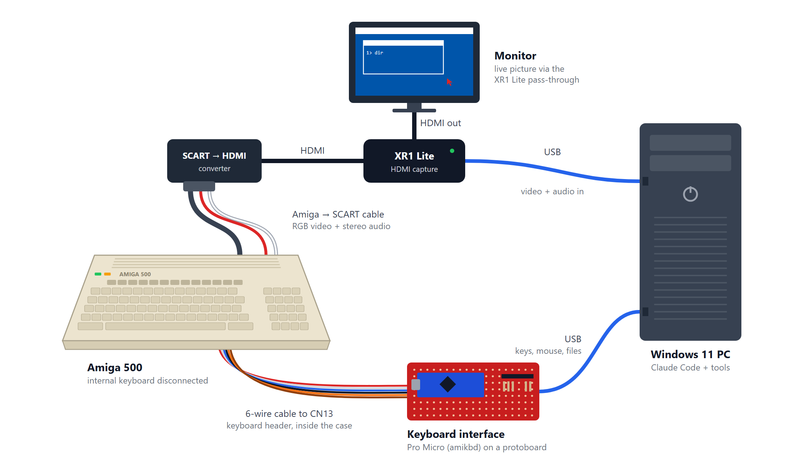
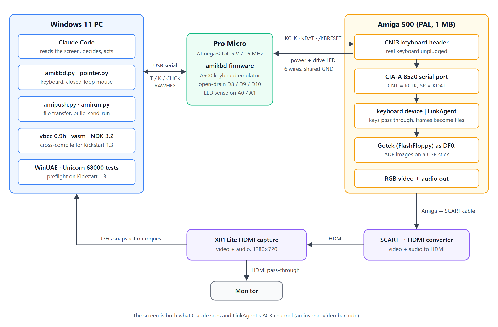
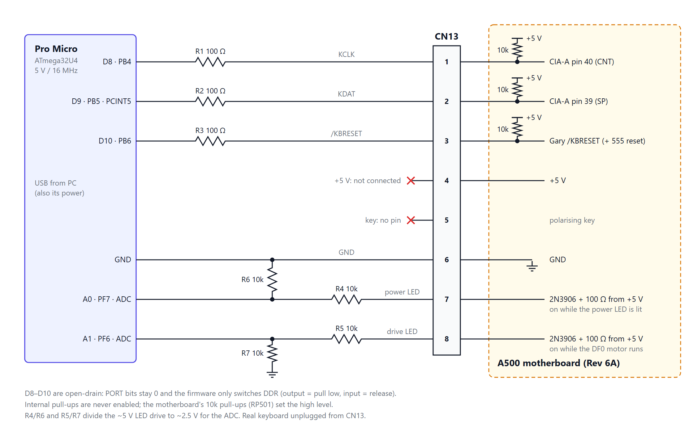
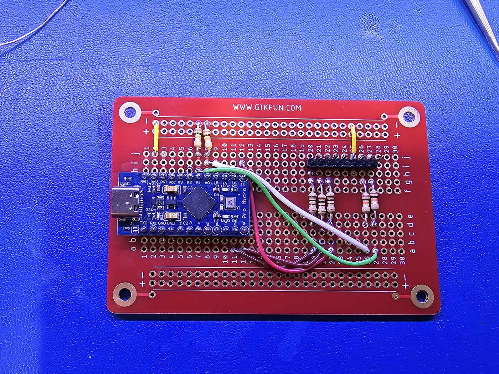
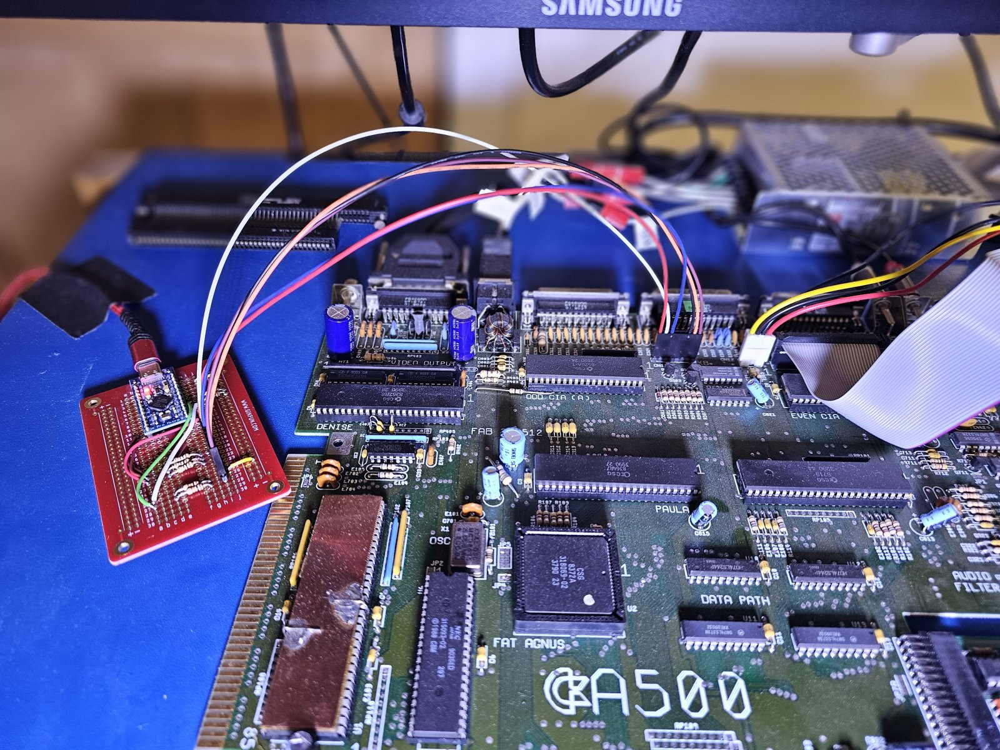
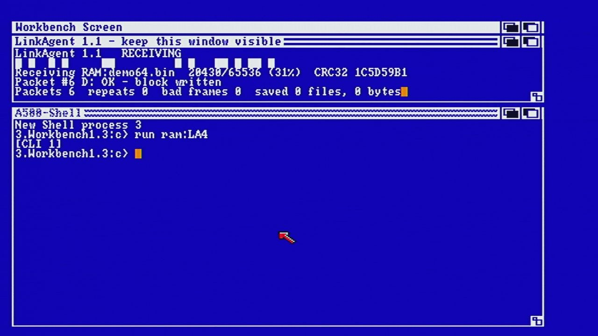
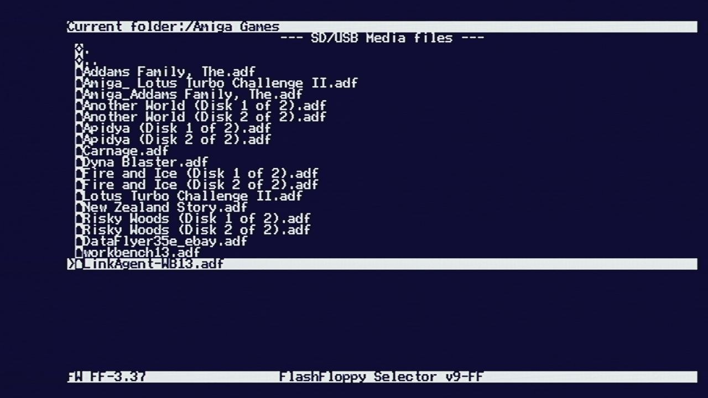

# Amiga Keyboard Interface

Remote control for a real Amiga 500 through its keyboard header: keyboard and mouse input, file transfer,
and a compile-send-run loop for Kickstart 1.3, all from a Windows PC. It was built so that Claude Code can
operate the machine directly: read the screen, type, click, change disks, copy files across and run
programs.

No changes to the Amiga are needed. A small microcontroller board pretends to be the keyboard, and an HDMI
capture of the Amiga's video lets the PC see the screen.

Write-up: *Using Claude to Remote Control My Amiga 500* on techtravels.org (link coming soon).



## What's here

| Path | What |
|---|---|
| [`firmware/amikbd/`](firmware/amikbd/) | Arduino Pro Micro firmware that emulates the A500 keyboard, plus [PROTOCOL.md](firmware/amikbd/PROTOCOL.md) |
| [`tools/`](tools/) | PC side: `amikbd.py` (keys and mouse), `pointer.py` (closed-loop pointer), `amipush.py` (file transfer), `amirun.py` (build, send, run), `ledwatch.py` |
| [`devchain/`](devchain/) | LinkAgent, the 68000 receiver that turns keyboard frames into files, its tests, the vbcc config and examples. See [devchain/README.md](devchain/README.md) |
| [`hardware/WIRING.md`](hardware/WIRING.md) | Board wiring, pinout and parts |
| [`USAGE.md`](USAGE.md) | Operator guide: reading the screen, sending input, waiting for the disk, troubleshooting |
| [`CLAUDE.md`](CLAUDE.md) | Quick reference that Claude Code reads when working in this repository |



## Hardware

An Arduino Pro Micro (ATmega32U4, 5 V / 16 MHz) on a protoboard, three 100 Ω and four 10 kΩ resistors,
and six wires to the A500's internal keyboard header, CN13. The real keyboard is unplugged from CN13 while
the board is connected. The Pro Micro is powered from USB; only ground is shared with the Amiga.







Check the CN13 pinout with a meter before connecting: some boards are reported to have clock and data
swapped. Full details in [hardware/WIRING.md](hardware/WIRING.md).

For video you need the Amiga's screen as a JPEG on request over HTTP. Any capture chain works; the one
used here is an Amiga-to-SCART cable, a SCART-to-HDMI converter and an HDMI capture device with
pass-through, so a monitor still shows the Amiga live. Point the tools at it with:

```powershell
$env:AMIGA_SNAPSHOT_URL = "http://localhost:8080/snapshot"
```

## Quick start

1. **Flash the firmware** with the Arduino IDE or arduino-cli (board: Arduino Leonardo):

   ```bash
   arduino-cli compile --upload -b arduino:avr:leonardo -p COM5 firmware/amikbd
   ```

2. **Connect** the board to CN13 (red wire on pin 1), plug in USB, then power on the Amiga. The board
   syncs with the Amiga during boot by itself.

3. **Check and type:**

   ```bash
   pip install pyserial pillow numpy
   python tools/amikbd.py S                       # expect sync=1
   python tools/amikbd.py 'T dir\n' 'WAITDISK'    # single quotes so \n reaches the board
   ```

4. **Mouse:** `python tools/pointer.py --goto 650 262` then `python tools/amikbd.py "CLICK L 2"`.

See [USAGE.md](USAGE.md) for everything else.

## File transfer: LinkAgent



LinkAgent is a small 68000 program for Kickstart 1.3. It takes over the CIA-A keyboard serial interrupt
(through cia.resource, and gives it back on exit), so every keyboard frame carries one byte of data.
Ordinary keys still pass through to the system. The PC reads the acknowledgements from a barcode of
inverse-video spaces in the agent's window, through the video capture. Files are written to `.part` and
renamed only once their size and CRC32 match. Measured throughput is about 2 KB/s.

```bash
python devchain/build.py --workbench path/to/your/Workbench1.3.adf   # LinkAgent + a bootable Gotek image
python tools/amipush.py ping
python tools/amipush.py put local.bin RAM:local.bin
```

You supply your own Workbench 1.3 disk image; none is included. Setup, the wire protocol and the tests
are in [devchain/README.md](devchain/README.md).

## Compile, send and run

With vbcc 0.9h (and its `m68k-kick13` target) in `devchain/vendor/vbcc/`, Hyperion's free NDK 3.2 in
`devchain/vendor/NDK3.2/`, and `devchain/config/a500` copied into `devchain/vendor/vbcc/config/`:

```bash
python tools/amirun.py devchain/examples/hello/hello.c
```

This compiles the program, checks that Kickstart 1.3 can load it, sends it with LinkAgent, types its name
into the Amiga Shell and saves a snapshot of the result.

## Changing disks

On a Gotek running FlashFloppy, the Amiga-side selector is driven entirely by keys, so disk images can be
changed remotely too.



## Tests

```bash
python devchain/build.py
python -m pip install unicorn==2.1.4 amitools
python -m unittest discover -s devchain/tests -v
```

The tests run the assembled LinkAgent code in the Unicorn 68000 emulator with stubbed Exec, DOS and CIA.

## Licence

MIT. See [LICENSE](LICENSE).
