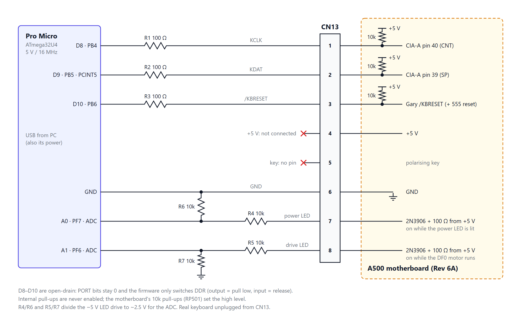

# Hardware: Pro Micro to the A500 keyboard header

A protoboard carrying an Arduino Pro Micro (ATmega32U4, 5 V / 16 MHz) and one 8-pin male header **J1**,
which takes a cable to the motherboard's keyboard header **CN13**. The real keyboard is unplugged from
CN13 while the board is connected (no pass-through).

## CN13 / J1 pinout (A500 Rev 6A schematic)

| Pin | Signal | Pro Micro | Notes |
|---|---|---|---|
| 1 | KCLK | D8 (PB4) via 100 Ω | open-drain only |
| 2 | KDAT | D9 (PB5) via 100 Ω | open-drain only |
| 3 | /KBRESET | D10 (PB6) via 100 Ω | open-drain, active low |
| 4 | +5V | **leave unconnected** | |
| 5 | key | none | polarising key |
| 6 | GND | GND | common ground |
| 7 | power LED | A0 (PF7) via 10 kΩ, 10 kΩ to GND | analog sense |
| 8 | drive LED | A1 (PF6) via 10 kΩ, 10 kΩ to GND | analog sense |

**Verify pins 1 and 2 with a meter first.** CN13 pin 1 should go to CIA-A (8520) pin 40 (CNT = KCLK) and
pin 2 to CIA-A pin 39 (SP = KDAT). Published pinouts disagree, and some boards are reported to have them
swapped.

D8/D9 are PCINT0 pins, so the hardware pin-change flag latches the Amiga's short acknowledge pulses.
47 Ω parts can substitute for the 100 Ω series resistors.

## Power
- Power the Pro Micro **from USB only**. Tie GND to the Amiga; leave the Amiga's +5V off the Pro Micro's
  VCC/RAW.
- The firmware never enables the internal pull-ups on D8/D9/D10. The lines idle as inputs with PORT=0 and
  are pulled low only by setting DDR=1. The motherboard's 10 kΩ pull-ups (RP501) set the high level.
- Plug in USB before powering the Amiga.

## LED sense
CN13 pins 7 and 8 are driven by 2N3906 high-side switches on the motherboard, with 100 Ω in series. They
source +5 V when on and float when off. On the A500 the LEDs themselves are in the keyboard, so with the
keyboard unplugged the board reads these pins instead.
- The 10 kΩ/10 kΩ divider gives about 2.5–2.7 V when on and 0 V when off (the pull-down defines it). That
  is below the AVR's digital high threshold, so the firmware reads it with the ADC (threshold about 1.2 V).
- The 10 kΩ series resistor limits back-feed into an unpowered Pro Micro to about 0.25 mA.
- The drive LED is the useful one: it tells the PC when disk access has finished (`WAITDISK`).

## Why no keyboard pass-through
The A500 keyboard drives /KBRESET from a totem-pole 74LS27, which would fight the Pro Micro whenever it
pulled reset low. To add one anyway: a second header wired in parallel (pin 5 removed for the keyed plug),
and a Schottky diode (1N5817/BAT85) in its pin 3, cathode toward the keyboard.

## Parts
| Qty | Part |
|---|---|
| 1 | Pro Micro 5 V/16 MHz + 2× 1×12 male headers |
| 1 | Solderable breadboard / protoboard |
| 1 | 1×8 male 0.1" header (J1) |
| 1 | 8-way female–female 0.1" Dupont cable, ~30 cm (J1 to CN13) |
| 3 | 100 Ω resistor (or 47 Ω) |
| 4 | 10 kΩ resistor (2 series + 2 pull-down) |

## Before first power-up
1. Meter-check CN13 pin 1 to CIA-A pin 40, pin 2 to CIA-A pin 39, and pin 6 to GND.
2. Mark pin 1 on J1 and on both cable ends.
3. Confirm there is no continuity between J1 pin 4 (+5 V) and the Pro Micro's VCC/RAW.
4. Unplug the real keyboard from CN13 before connecting the cable.
